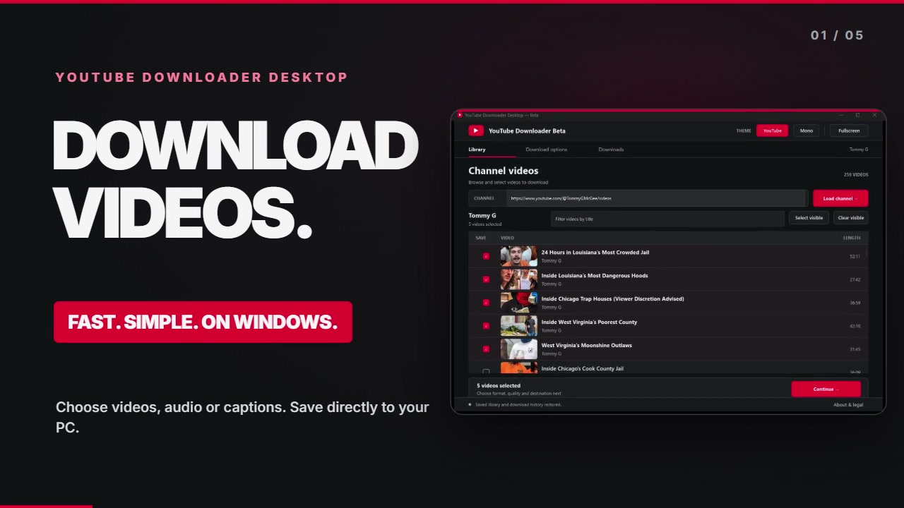
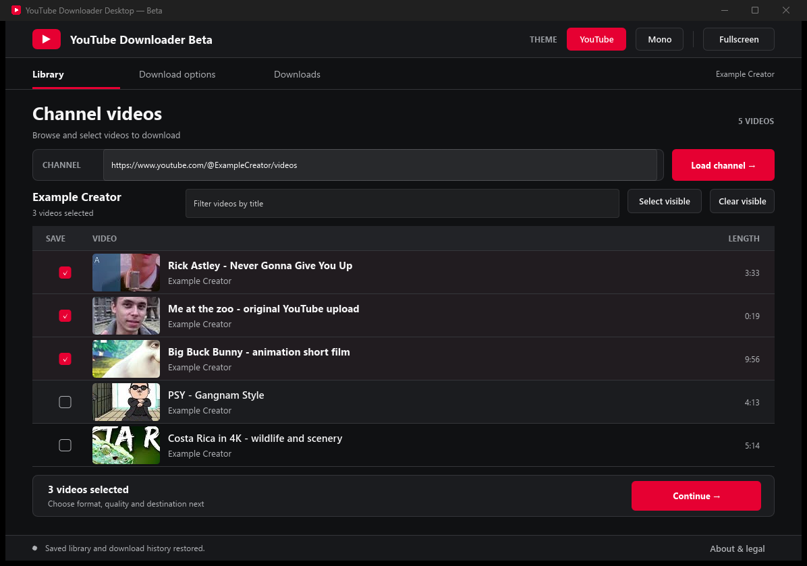
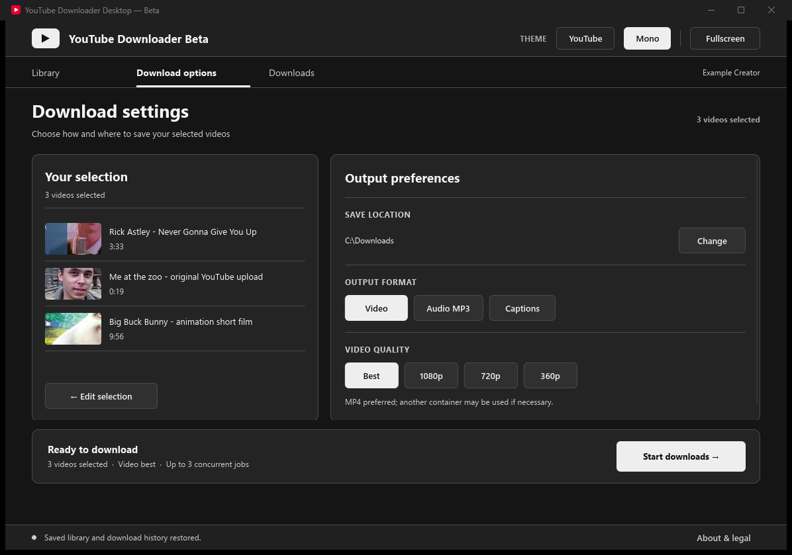
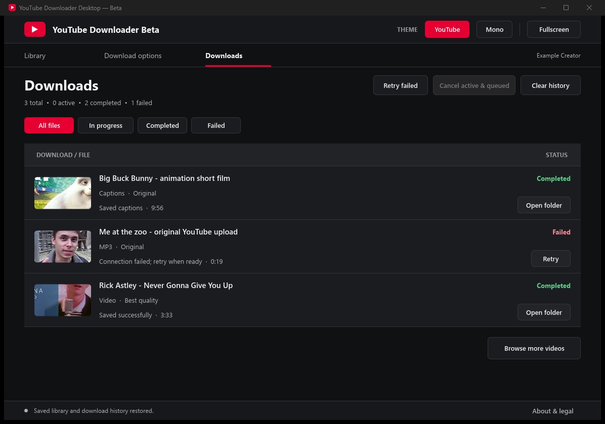
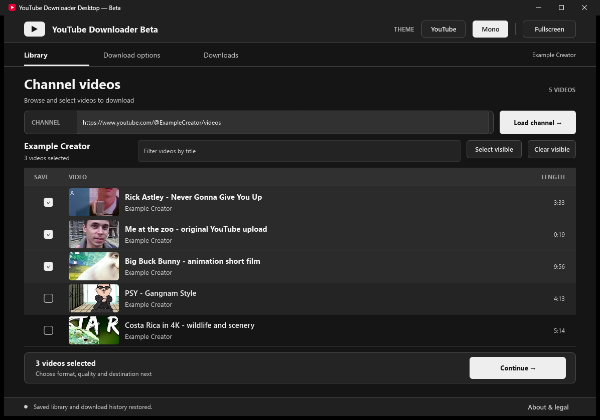

# YouTube Downloader Desktop

**Windows x64 | Beta | Free and open source**

A Windows app for finding videos on a public YouTube channel, choosing what to save, and downloading permitted videos, audio, or available captions. It runs on your PC; you do not need a browser extension, Python, or an account with this project.

[](https://github.com/Ticklect/youtube-downloader-desktop/releases/download/desktop-beta-lazy-loading/YouTube-Downloader-Desktop-Demo.mp4)

**[Watch or download the 20-second demo](https://github.com/Ticklect/youtube-downloader-desktop/releases/download/desktop-beta-lazy-loading/YouTube-Downloader-Desktop-Demo.mp4)** | **[Download the Desktop Beta](https://github.com/Ticklect/youtube-downloader-desktop/releases/latest)** | [See download options](docs/screenshots/options.png)

The demo shows selecting videos from a channel, choosing video or audio formats and download quality, and managing downloads in the native Windows app.

## Install

1. Open the [latest Desktop Beta release](https://github.com/Ticklect/youtube-downloader-desktop/releases/latest) and download the **Windows x64 ZIP**.
2. Right-click the ZIP and choose **Extract All**. Do not run the app from inside the ZIP.
3. Open the extracted folder and run **`YouTube Downloader Desktop.exe`**.

Keep the `bin` folder beside the EXE. It contains the tools the app needs to download and process media. The portable download does **not** require a separate installation of Rust, Python, FFmpeg, or yt-dlp.

The Beta is currently **Windows x64 only**. It is not code-signed and has no installer, so Windows may show an unrecognized-app warning. Only run files you trust; the release includes a `SHA256SUMS.txt` file if you want to verify the ZIP.

## How to use it

1. Copy a public YouTube channel address, such as `https://www.youtube.com/@ChannelName/videos`.
2. Paste it into the **Library** page and click **Load channel**.
3. Tick the videos you want to save. Use the search box to narrow the list.
4. Click **Continue**, then choose the download folder, format, and quality.
5. Start the downloads. Open **Downloads** to check progress, open finished files, cancel active jobs, or retry failures.

You can also switch between the **YouTube Red** and **Mono** themes. The app remembers your channel, selected videos, settings, and download history between launches.

## Screenshots

**Library — browse a channel and select the videos you want:**



| Download options | Downloads and history |
| :---: | :---: |
|  |  |

**Mono theme** — the same Library with a neutral colour scheme:



The main Library screenshot shows a real public channel with **259 videos loaded** during pagination testing. The other screenshots use isolated example data. All were captured from the updated desktop Beta.

## What it supports

| Feature | Current Beta |
| --- | --- |
| Channel browsing | First 200 public videos immediately; scrolling near the bottom loads another 200, up to 1,000 |
| Video | Best available, 1080p, 720p, or 360p, when available |
| Audio | MP3 output |
| Captions | English captions, if available for the video |
| Downloads | Folder selection, progress, cancellation, retry, and history |
| Processing | Local yt-dlp, FFmpeg, and Deno tools included in the portable ZIP |

Some uploads, formats, or captions may not be available. YouTube can change how videos are delivered, so not every download will succeed. Private, members-only, login-restricted, and DRM-protected content are not supported. This is a **Beta**, not a guarantee of uninterrupted downloads.

To browse older uploads, keep scrolling down the **Library** list. The app loads more in batches instead of scanning the full channel upfront. Your selections remain checked while the next batch loads; if a request fails, use **Retry loading** at the end of the list.

## Responsible use and legal notice

**Only use this software to download material you are permitted to download.** For example, this may include videos you created, material for which you have the rights holder's permission, or content whose licence or applicable law permits downloading. Check the actual permissions before downloading: **a video being publicly viewable does not automatically mean you have permission to save or redistribute it.**

You are responsible for your own use of the software, including complying with copyright law, privacy rights, applicable regulations, and the terms of any platform or service you access. Do not use it to infringe someone else's rights or bypass DRM, paywalls, authentication, or other access restrictions. Downloading a file does not grant permission to republish or distribute it.

**Disclaimer:** This project is provided **"as is"**, without warranties, as described in the [AGPL-3.0 licence](LICENSE). To the extent permitted by applicable law, the authors and maintainers disclaim liability for misuse of the software, infringement by users, lost data, service restrictions, or other damage arising from its use. **This notice does not automatically remove legal liability or override rights and obligations that cannot legally be excluded.**

This is an independent project. It is **not affiliated with, sponsored by, or endorsed by YouTube or Google**. YouTube and Google names and marks belong to their respective owners.

## For developers

The desktop app is written in **Rust** and uses **Slint** for its native UI. On Windows, install stable Rust with the MSVC toolchain and Windows SDK/C++ build tools, then run:

```powershell
cargo fmt --all -- --check
cargo test --locked
cargo clippy --locked --all-targets -- -D warnings
cargo build --release --locked
powershell -NoProfile -ExecutionPolicy Bypass -File scripts/package-windows.ps1 -Tag Local-Build
```

The packaging script downloads and checksum-verifies the required tools. It creates a portable folder and ZIP under `dist/`, and refuses to overwrite an existing build with the same tag. To run the Windows GUI smoke tests against that package:

```powershell
powershell -NoProfile -ExecutionPolicy Bypass -File scripts/smoke-beta-acceptance.ps1 -Executable 'dist\YouTube Downloader Desktop Beta Local-Build\YouTube Downloader Desktop.exe' -CaptureMatrix
```

Those tests use isolated sample data, not your real downloaded files. Your regular app settings and history are stored under `%LOCALAPPDATA%\YouTube Downloader Desktop\`.

## Other versions and licences

A separate **browser-only extension** is being developed as an alternative for people who do not want a desktop app. It is experimental, has different download limitations, and is **not included in this repository or release**. The old extension-plus-Python-helper project is retired; its source remains in Git history, not in the current desktop codebase.

This project's source is licensed under **[AGPL-3.0](LICENSE)**. The UI uses [Slint](https://slint.dev/) and includes its attribution under **About & legal**. Bundled yt-dlp, FFmpeg, and Deno have their own upstream licence terms and notices.
